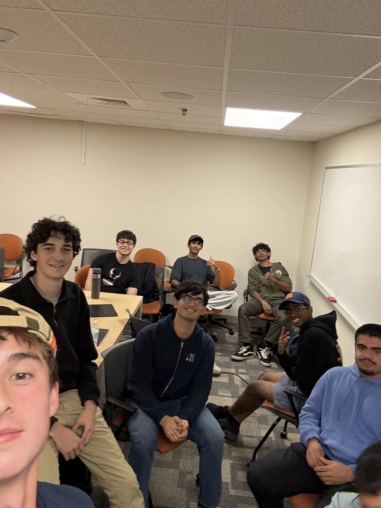

# Harsha Gaddipati (YC S25)

Date: Thursday, September 24, 2026, 6 p.m.

Organizer-reported attendance: 13 members.

Source: https://www.uva.builders/events/harsha-gaddipati

## Published session recap

The session

The co-founder and CEO of Slashy joined us over Google Meet for a conversation about campus startups, pivoting from general agents to email, and what engineers need to know when AI writes the code.

Getting the first users

His first campus project started after a friend showed him Northwestern’s Marriage Pact. Georgia Tech did not have an equivalent, so he spent the next twelve hours researching matchmaking and launched a first version with friends in about two days. They called it Georgia Tech Dating Blind, which became GT Match. He later worked on college dating apps including Bubble Date.

Posting online brought roughly 50 to 100 signups. Then he spent several hours putting flyers on buildings across campus, and the project spread. The lesson was the unglamorous work: founders say they cannot get users, but often have not tried the straightforward things that put a product in front of people.

Choosing a co-founder

Friendship does not tell you whether someone will work well with you. He looks for intelligence, trust, and a willingness to do the boring work reliably. You learn whether someone will finish compliance paperwork by Tuesday by working with them, not by simulating a company together.

He had known his current co-founder for about a day when they started working together. His advice was to start testing the working relationship sooner. For solo founders, the question is whether bringing someone in improves the company’s chances enough to justify the equity. At the earliest stage, speed and finding out whether the idea works matter more than protecting a percentage of something that may be worth nothing.

From general agents to email

Slashy’s general agent had users who loved it but used it less each week. They tried ChatGPT or Claude first, and as those products improved, fewer tasks reached Slashy. That mattered more than the positive feedback: he did not see a durable business competing with the model labs on general work.

The team pivoted after raising its seed round. Investors supported the change; in his account, they had backed the founders and their ability to build agents more than the original idea. Working at the edge of a new field had built skills they could carry into a different product.

The email client is a bet on an interface people will keep using. He expects email-heavy professions, such as recruiting and executive search, to need a familiar workspace for several more years. The goal is to build an assistant around that work, including scheduling and browser tasks, while earning enough distribution to adapt as habits change.

The bar for junior engineers

He was less optimistic about the traditional junior role than about capable people coming out of college. AI can already handle much of the small implementation work that used to give juniors time to learn. His expectation at a startup is that a new hire can contribute immediately, reason about architecture, and design good systems with AI.

That does not mean students have no advantage. They may know the tools better than experienced founders who spend their days running companies. But the role looks more like a founding engineer than a long apprenticeship. He distinguished this from big tech, where he still sees more room for gradual training.

Owning the work

“Talk to my agent” is not a sufficient answer inside his team. If he asks an engineer about an important decision, he expects the engineer to understand it. The reason to hire someone is to have another person thinking deeply about a problem the rest of the team does not have the bandwidth to own.

He sees more value in agents talking directly in support workflows, where two people may otherwise spend their time passing questions and answers between their AIs. Inside a team, handing off the explanation can mean nobody owns the knowledge.

Reading code and building intuition

He said startup incentives push engineers toward shipping without reading every line, but he reads the code in his own pull requests. When he is coding, it is usually because something important needs attention.

One example was slow email rendering. Reading the code exposed repeated comparisons of large HTML strings and helped him find a cheaper check. The broader point was that AI can write the implementation while a person’s technical intuition still determines where to look. Learn the fundamentals, read generated code deliberately, and keep thinking while the agent works.

Choosing a startup to join

Look closely at the founders: do you trust them, and will they fight for your career? He described long hours at his own company, with more emphasis on output than on tracking when people take a break. Expectations vary, and the founder’s habits shape the team’s even when they are not explicit rules.

He argued that the tradeoff of a startup only makes sense if the founders help you grow. That can include introductions, support for your next job, or help starting a company of your own. A founder who treats ordinary personal commitments as a problem is someone he would avoid working for.

Finding an advantage

Building a product is easier; building a successful business still requires doing something better than the alternatives. That advantage might be distribution, willingness to do tedious work, or the time to pursue a market. It does not have to be being the smartest founder in the room.

He advised students not to wait until they feel like experts. Spending months working deeply in a field can create the expertise they think they need before starting. Whether the problem is worth solving still has to be learned by talking to customers and trying to solve it.

Sales, marketing, and the human work

He expects more roles around customers as engineering becomes more productive. Slashy deliberately keeps people involved in parts of customer support because the human attention helps win business. Automating everything is not the goal if it makes the company less effective.

On marketing, he pointed to small teams using AI to manage creative work and larger advertising budgets. Performance marketing also makes it easier to connect that work to revenue. He was less certain about how far sales can scale: relationships still take attention, and each additional deal competes for it.

Slashy was not hiring at the time of the talk, but he invited students to email him for introductions to friends who were.

## Published images

Source: https://www.uva.builders/events/harsha-gaddipati/selfie-1200.webp

