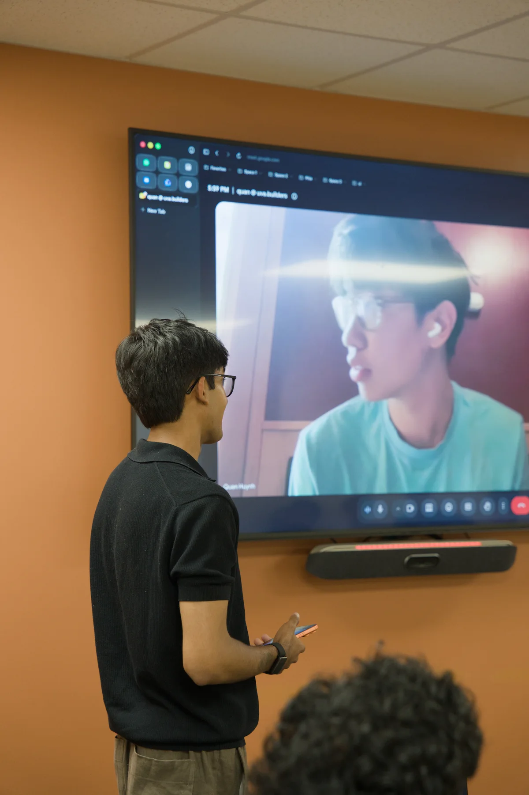
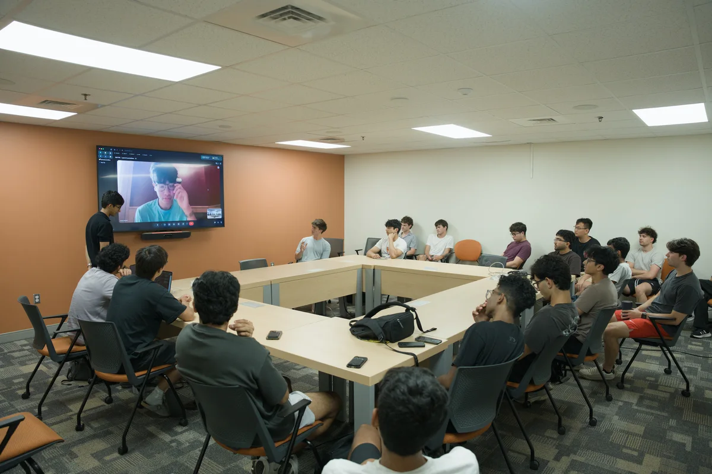
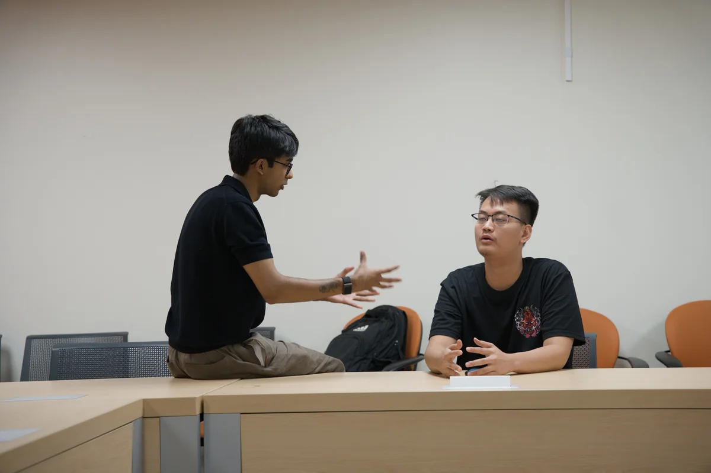

# Quan Huynh (YC W26)

Date: Thursday, September 10, 2026, 6 p.m.

Organizer-reported attendance: 25 members.

Source: https://www.uva.builders/events/quan-huynh

## Published session recap

The session

A co-founder of Haladir joined us for a conversation about finding a problem, acquiring customers, and building a team.

Finding Haladir

Haladir builds logistics software for warehouse efficiency and supply chain optimization.

The team found logistics through research. They saw an industry with substantial room for innovation.

Finding direction

He started with hackathons in high school, sneaking into college competitions. His first product was a browser extension that parsed terms and conditions before signing. Early projects led to an accelerator interview—but he did not get in initially.

The shift came when he stopped optimizing for accelerator admission and started asking what problem he could actually solve. During the batch, the team generated ideas daily and pitched across industries. Sales cycle length and willingness to pay helped them eliminate ideas and arrive at logistics.

Failure, pressure, and resilience

He described repeated failures despite real effort before landing on logistics. Long sales cycles and customers unwilling to pay the target price were signals to move on. In his experience, capital was rarely the blocker: experiments could be inexpensive.

He described pressure as a signal that you care and antifragility as the goal. Sales, pitching, and navigating rooms take repeated failure. His advice was to keep going: “Most startups fail because you give up, not because you tried for 10 years and nothing came out.”

Getting in the room

VCs can help with introductions, but warm introductions from happy customers become more valuable over time. He recommended reaching out to VPs: they know the problems and are more accessible than the C-suite.

For Haladir’s first client, the team reached out widely and found a design partner. He advised saving major introductions until the product is ready instead of figuring out the product with a marquee customer.

Learn to ask better questions. He recommended watching how strong sales representatives run calls.

Hiring and taste

He looks for taste, interpersonal compatibility, competency, and rate of learning. Personal websites and projects make depth of interest visible. Shallow projects presented as deep interests, or an inability to defend an opinion under pushback, are red flags.

For engineers, he values breadth over mastery of a particular language and sees functional programming experience as a signal of taste. He also argued for making firing decisions quickly, especially before someone signs a lease or takes on debt: “You have to be good at firing, not just hiring.”

Advice for student founders

Talk to three people a day in an industry you care about, and iterate on ideas before building. Go deep into a niche where you have exposure or access through professors, labs, or local businesses. He cautioned against defaulting to obvious niches such as developer tools and edtech, where he believes much of the low-hanging fruit is gone.

Do not fixate on fundraising. Consider the terms carefully and keep fundraising in perspective.

Raise money to accelerate, not to validate. Revenue first, then scale.

## Published images

Source: https://www.uva.builders/events/quan-huynh/dsc04129-1200.webp

Source: https://www.uva.builders/events/quan-huynh/dsc04128-1200.webp

Source: https://www.uva.builders/events/quan-huynh/dsc04120-1200.webp
