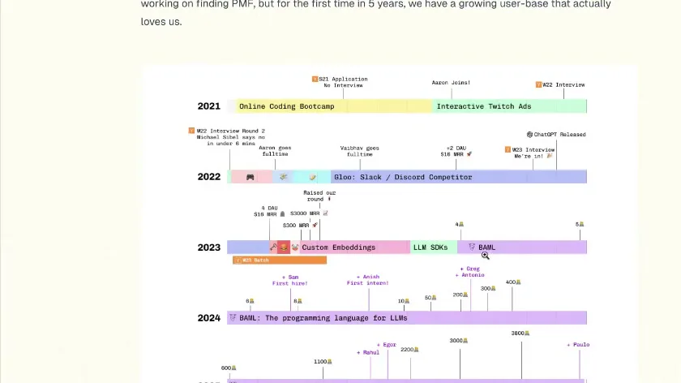
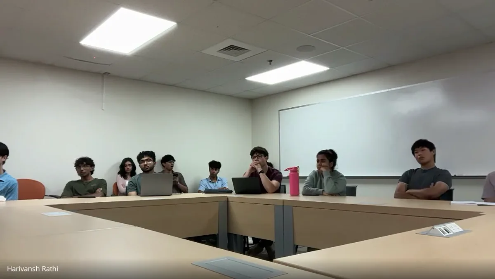

# Vaibhav Gupta (YC W23)

Date: Thursday, September 17, 2026, 6 p.m.

Organizer-reported attendance: 17 members.

Source: https://www.uva.builders/events/vaibhav-gupta

## Published session recap

The session

The co-founder of Boundary and creator of BAML joined us over Google Meet for a conversation about pivoting, picking a co-founder, and how to grow fast early in a career.

From robots to Boundary

He graduated from UT in 2015 after a college spent on robotics: a quadcopter with a home-built flight controller that only knew how to go up, and legged robots he taught to walk with reinforcement learning.

At 21 he joined the team at Microsoft that became HoloLens, then left to run a coding bootcamp, Life++, which made about $70,000 in six months before he decided he did not want to make money in edtech. He went on to lead performance work on face unlock for the Pixel 4 at Google, then wrote optimization code at D. E. Shaw that took one system from 33 hours to under five minutes.

After a breakup and some questioning of his life choices, he realized he wanted to start a company. His co-founder Aaron had already jumped in; he followed four months later.

Twelve pivots to BAML

The company went through YC Winter 2023 as Gloo and then through what he called pivot hell: video game software, HR tech, Twitch ads, a Slack competitor, custom embeddings, automated drive-thrus. Custom embeddings reached $15,000 in monthly revenue, but it felt like white-glove consulting rather than a product with a billion-dollar outcome, so they walked away.

BAML started on August 10, 2023, out of frustration with the code quality of the AI tooling they were using. The bet is historical: Java arrived with operating systems and JavaScript with the browser, so a new platform, where humans no longer write or read most code, needs its own language.

For months the user count stayed in the single digits, which he described as miserable. What kept them going was retention: the people who did adopt it deleted large amounts of old code and did not leave.

The college startup decision

In college he worked on Light Labs, a non-invasive glucometer, and interviewed with Paul Graham at YC in 2014. He let offers from Facebook and Microsoft expire to keep working on it, and someone offered $50,000, which felt like infinite money to a student.

A Microsoft engineer told him the real problem was that he was not making a decision. He slept on it, woke up wanting to work for that person, and took the job to be around people he could learn from. He does not regret either the attempt or the choice.

Co-founders and delusion

He optimizes for fun: “Life is a dopamine maximization engine.” A good co-founder covers your weaknesses, thinks differently, and makes the lows better. He met Aaron in Seattle a year out of college and, seven years later, sent him a Facebook message proposing they start something. Their core strength is being able to disagree strongly, in public and in private, without taking it personally. Co-founder breakups are the number one reason companies fail.

On conviction versus market signal: “To be a founder, you have to be somewhat delusional. You have to believe something no one else believes, or someone would have done it already.” The check is measurement against your own runway. If you have a year, do not pick a company that requires you to be delusional for five.

Hiring

Boundary hires rarely and asks for one thing instead of a resume: an email titled “Why I’m awesome” with the three most incredible things you have ever done. They look for people who like hard problems, and they have helped their own people take other offers, because the team should grow rather than be used.

Big tech or a startup

Maximize your growth rate and find a manager you genuinely want to work for, whatever the company size. Early in a career, 45 to 50 hours a week on problems you find exciting produces outsized output relative to peers, and annual promotions are a reasonable measure of whether you are growing faster than they are.

Autonomy is earned the same way everywhere: produce value and your scope expands. He had greenfield work at both Microsoft and Google. The difference between big tech and a startup is the consequence of failure, a missed promotion versus a business that stops existing.

AI and junior engineers

He called this a golden age for junior engineers. It took him years to get good because every question waited hours for a senior engineer to answer. Now nothing stops a junior from getting better except their own willingness to learn. Use AI to close the gap, then bring experts specific, well-researched questions.

Applying to YC

The advice is the same as for building a business: find users, find people, build something people want. A student rarely has an accomplishment that stands out against a 40-year-old who has built four companies, so apply with the users you got, the metrics you have, and the hustle you did.

He is always hiring interns and full-timers. Send him the three most incredible things you have done.

## Published images

Source: https://www.uva.builders/events/vaibhav-gupta/pivots-1200.webp

Source: https://www.uva.builders/events/vaibhav-gupta/room-1200.webp
